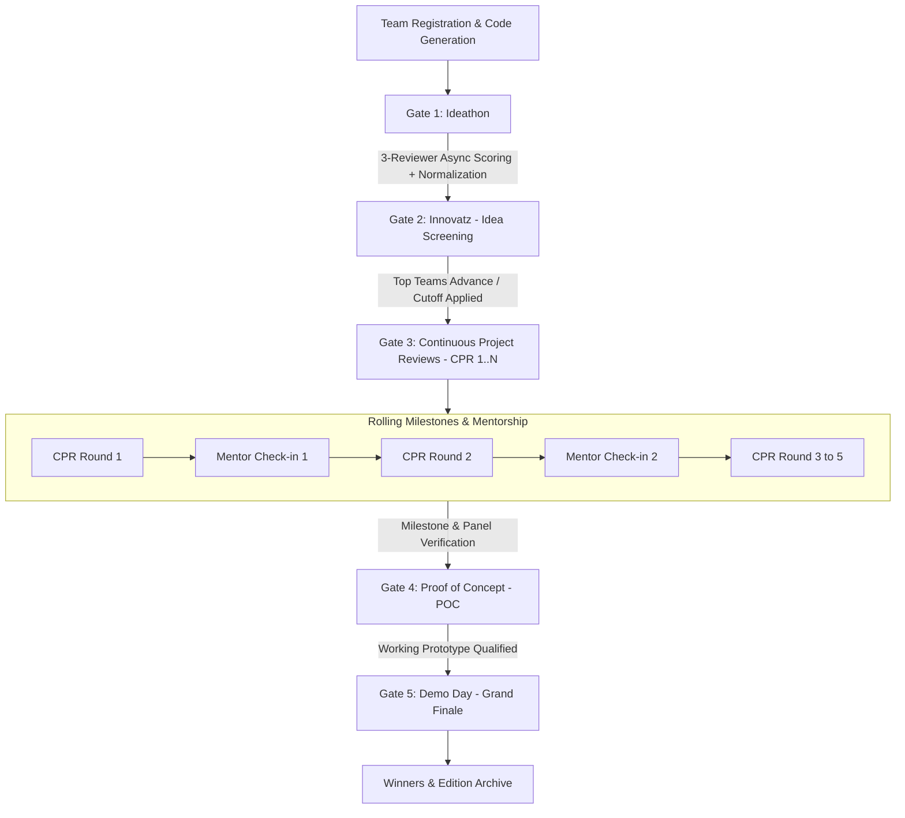
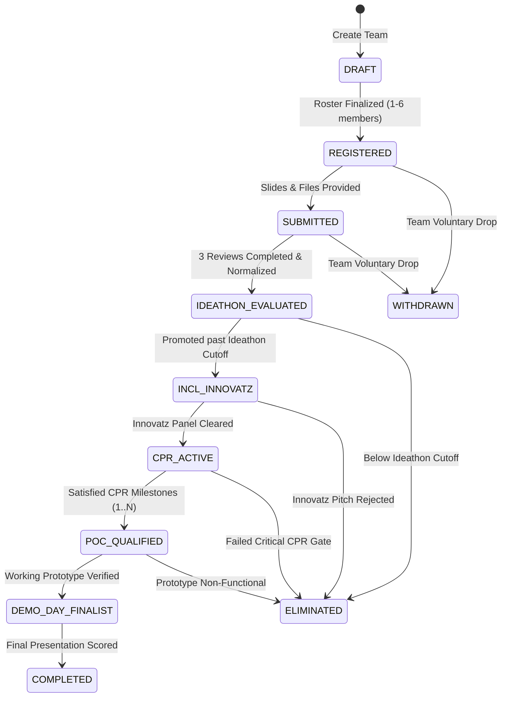

# Event-and-Gate Playbook
## Project: HackTrack — Multi-Edition Collegiate Innovation Platform
**Document Version:** 1.0.0  
**Phase:** Phase 0 — Discovery and Documentation  
**Status:** Approved for Implementation Planning  

---

## 1. Program Lifecycle Architecture

HackTrack orchestrates an annual multi-month innovation journey through a sequential, gated event pipeline. Each event in the pipeline functions as an academic milestone and operational filter, transitioning teams through progressive stages of maturity.

---

## 2. Event & Team State Machines

### 2.1 Event Operational States
Each event stage in an edition transitions through an explicit lifecycle managed by `Coordinator (Manage)`:

| Event State | System Behavior & Permissions |
| :--- | :--- |
| `UPCOMING` | Event details published. Rubrics can be configured. Teams can view prerequisites. No submissions allowed. |
| `REGISTRATION_OPEN` | Teams can sign up for the event stage or verify roster eligibility. |
| `SUBMISSION_OPEN` | Team Leads can submit/update their Google Slides URL. Real-time preview enabled. |
| `SUBMISSION_LOCKED` | Deadlines pass. Slides-link edits locked (read-only). |
| `EVALUATION_ACTIVE` | Evaluators assigned. Evaluator cockpit unlocked. Rubric scoring and comment submission enabled. |
| `EVALUATION_LOCKED` | Evaluator scoring locked. Normalization and coordinator moderation/overrides active. |
| `COMPLETED` | Gate decisions committed. Final scores and advancement flags published. Cohort promoted. |

---

### 2.2 Team Stage Progression States
A team moves through the following discrete state machine across an edition:

---

## 3. Detailed Gate Playbook: Entry, Execution & Exit Rules

---

### Gate 1: Ideathon (Asynchronous Idea Exploration)
* **Goal:** Broad cohort intake to evaluate novelty, societal impact, and feasibility of ~300 ideas.
* **Review Model:** **3 Independent Reviewers per Idea** (Asynchronous).

#### Entry Rules:
1. Team must be in `REGISTERED` state within the active edition.
2. Team size must be within bounds: $1 \le \text{members} \le 6$.
3. Exactly one valid Google Slides presentation URL submitted and embeddable.
4. Optional abstract / problem statement completed in team profile.

#### Execution & Scoring Workflow:
1. **Deadline Lock:** Coordinator transitions Ideathon to `SUBMISSION_LOCKED`.
2. **Automated Balanced Allocation:**
   - 300 teams $\times$ 3 reviews = 900 total reviews needed.
   - Algorithm distributes teams across evaluator pool ensuring conflict-of-interest checks (no mentor assigned to own mentee team).
3. **Evaluator Cockpit:**
   - Evaluators score assigned teams on weighted rubric (e.g., Problem 25%, Novelty 35%, Feasibility 25%, Deck Quality 15%).
   - Mandatory qualitative comments (min 20 characters) required per criteria.
4. **Statistical Normalization:**
   - Evaluator raw scores standard-normalized via Z-Score algorithm:
     $$Z_{i,j} = \frac{X_{i,j} - \mu_j}{\sigma_j}$$
   - Scaled to global cohort distribution ($S_{\text{norm}} = 70 + Z \times 15$, clamped between 0 and 100).
   - Team Final Score = Average of 3 normalized reviewer scores.

#### Exit Rules (Promotion Criteria):
- Ranked by composite normalized score.
- Coordinator applies Top-K cutoff (e.g., Top 100 teams advance) or minimum score threshold (e.g., $\ge 65.0$).
- Promoted teams transition to `INCL_INNOVATZ`. Teams below threshold transition to `ELIMINATED` with published feedback.

---

### Gate 2: Innovatz (Idea Screening & Live Pitch Panel)
* **Goal:** Live panel defense of top ideas to filter committed teams ready for engineering execution.
* **Review Model:** Panel Review (Panel of 2–3 evaluators per track/breakout room).

#### Entry Rules:
1. Team state must be `INCL_INNOVATZ`.
2. Team must confirm presentation attendance.
3. Updated Google Slides deck verified.

#### Execution Workflow:
1. Coordinators assign teams to panel tracks (e.g., AI/ML, Hardware/IoT, HealthTech, Web3/FinTech).
2. Live pitch: 5-minute presentation + 3-minute Q&A.
3. Panelists submit synchronized rubric scores in real time via Evaluator Cockpit.

#### Exit Rules:
- Consensus panel rating $\ge$ track benchmark.
- Advancing teams (typically 40–60 teams) transition to `CPR_ACTIVE` and are officially matched with an assigned Mentor.

---

### Gate 3: Continuous Project Reviews (CPR 1 to N)
* **Goal:** Enforce engineering rigor, sprint cadence, and weekly milestone velocity.
* **Configuration:** Edition specifies between **3 to 5 CPR rounds** (e.g., CPR 1, CPR 2, CPR 3, CPR 4).
* **Inter-Gate Activities:** Rolling bi-weekly mentor check-in meetings.

#### Rolling Check-in & Milestone Rules:
- **Milestone Checklists:** Teams must submit GitHub commit hashes, architecture diagrams, and BOM (Bill of Materials) prior to each CPR round.
- **Mentor Sign-Off:** Mentor logs a bi-weekly check-in report confirming team health (`GREEN`, `YELLOW`, `RED`). A `RED` flag triggers coordinator intervention.

#### CPR Panel Evaluation:
- Each CPR round evaluates progressive criteria:
  - **CPR 1:** System Architecture, Tech Stack Selection, API Contracts.
  - **CPR 2:** Core Feature Implementation, Data Flow, Initial Prototype.
  - **CPR 3:** Integration Testing, Error Handling, UI/UX Completeness.
  - **CPR 4 (Optional):** Performance Benchmarking, Security Hardening.
  - **CPR 5 (Optional):** User Testing & Field Trial Data.

#### Exit Rules:
- Cumulative CPR velocity score calculated. Teams failing 2 consecutive CPR rounds without mentor remediation are flagged for conditional review or elimination.
- Successful teams transition to `POC_QUALIFIED`.

---

### Gate 4: Proof of Concept (POC Validation Gate)
* **Goal:** Rigorous technical validation ensuring the project is a functional, demonstrable system (no wireframe-only projects allowed into the finale).
* **Review Model:** Technical Evaluator Deep-Dive.

#### Entry Rules:
1. Team state: `POC_QUALIFIED`.
2. Working demo video link (e.g., Loom or unlisted YouTube) and public/private GitHub repository access provided.
3. Supporting links (repository, demo video, test results) verified.

#### Exit Rules:
- Evaluator marks `DEMO_VERIFIED = TRUE`.
- Top 15–25 teams selected as finalists; state transitions to `DEMO_DAY_FINALIST`.

---

### Gate 5: Demo Day (Grand Finale & Exhibition)
* **Goal:** High-stakes public showcase, keynote judging panel, and institutional prize distribution.
* **Review Model:** Grand Jury Scoring Panel.

#### Entry Rules:
1. Team state: `DEMO_DAY_FINALIST`.
2. Final presentation deck submitted and locked 24 hours prior to event opening.

#### Execution & Winner Determination:
1. Finalists pitch live before the Grand Jury.
2. Real-time scoring using weighted finale rubric (Technical Innovation 30%, Completeness 30%, Commercial Viability 20%, Pitch & Q&A 20%).
3. Platform aggregates jury scores, handles tie-breaking rules, and renders private coordinator podium rankings.
4. Winner announcement triggers transition of edition to `COMPLETED` and archives all submissions.

---

## 4. Tie-Breaking & Exception Protocols

### 4.1 Automated Tie-Breaking Logic
When two teams have identical normalized scores at a promotion boundary:
1. **Criterion Priority:** Compare scores on the highest-weighted rubric criterion (e.g., "Technical Feasibility").
2. **Reviewer Variance Check:** The team with the lower variance across its 3 reviewers is favored (indicating higher evaluator consensus).
3. **Milestone Velocity:** If still tied, compare on-time submission timestamps of rolling CPR deliverables.
4. **Coordinator Discretion:** If unresolved, Coordinator (Manage) receives a dedicated tie-breaker prompt in the moderation cockpit.

### 4.2 Handling Missing / Incomplete Evaluations
- If an Ideathon evaluator fails to complete an assigned review 4 hours before the deadline:
  - The system flags the review as `ORPHANED`.
  - Coordinator console highlights orphaned reviews with a 1-click "Reassign Reviewer" action that re-routes the idea to an on-call backup evaluator.
  - Normalization triggers only after all ideas have strictly 3 completed reviews.
