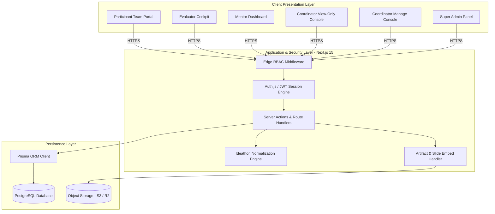
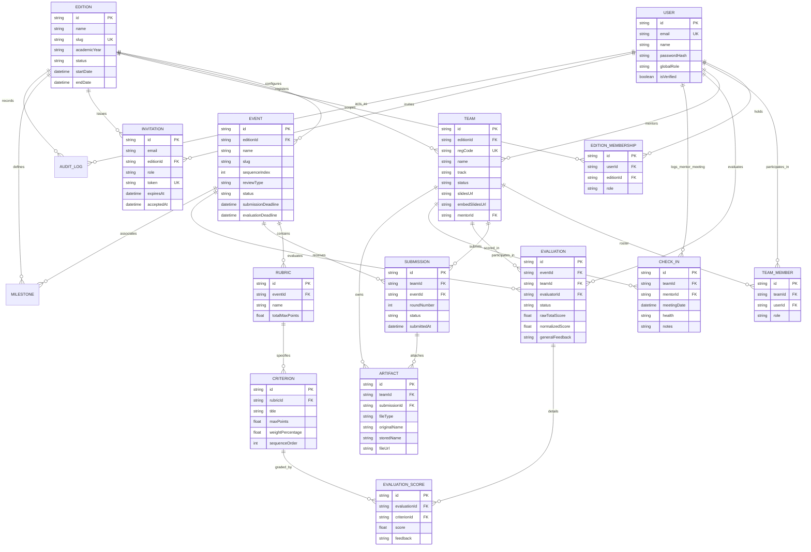

# Architecture Document & Architecture Decision Records (ADRs)
## Project: HackTrack — Multi-Edition Collegiate Innovation Platform
**Document Version:** 1.0.0  
**Phase:** Phase 1 — Foundation Architecture & Data Model  
**Status:** Approved  

---

## 1. System Architecture Context

HackTrack is architected as a modular, edition-partitioned web platform designed for continuous annual reuse. It decouples core domain models from hardcoded assumptions, allowing event sequences, weighted rubrics, and team lifecycles to be configured per edition without code modifications.

---

## 2. Complete Entity-Relationship (ER) Diagram

---

## 3. Architecture Decision Records (ADRs)

### ADR-001: Next.js 15 App Router & Server Actions Architecture
- **Status:** Approved
- **Context:** The platform requires low-latency page loads for evaluators and coordinators, alongside real-time forms for scoring and auto-saving drafts.
- **Decision:** Use Next.js 15 with TypeScript using the App Router. Critical business mutations (evaluations, gate transitions, registrations) use Server Actions and typed Route Handlers with Zod validation.
- **Consequences:** Provides end-to-end type safety, optimistic UI updates, and server-side RBAC verification without exposing business logic or database credentials to the client bundle.

### ADR-002: PostgreSQL & Prisma with Edition-Scoped Partitioning
- **Status:** Approved
- **Context:** The platform is reused across annual editions. Data from prior years must remain immutably preserved while active editions operate with full agility.
- **Decision:** Utilize a unified PostgreSQL database managed by Prisma ORM, where every operational model (`Event`, `Team`, `Milestone`, `EditionMembership`, `Invitation`) includes an indexed foreign key to `Edition`.
- **Consequences:** Simplifies cross-edition analytics for deans while ensuring that queries strictly filter by `editionId` during active operations. Avoids the overhead of managing multi-tenant database clusters.

### ADR-003: JWT Session Management with Per-Edition Role Claims
- **Status:** Approved
- **Context:** Users can hold different roles across different years (e.g. Participant in 2025, Evaluator in 2026), and coordinators need zero-roundtrip authentication checks at the Edge.
- **Decision:** Encode user identity, `globalRole`, and active `editionRole` directly in signed, HTTP-only, encrypted JWT cookies (`ht_session`).
- **Consequences:** Eliminates database lookups on every page navigation. Token refresh automatically updates when switching active editions.

### ADR-004: Strict RBAC Guard Middleware with Write-Protection for Coordinator View
- **Status:** Approved
- **Context:** Institutional stakeholders require read-only macro visibility (`Coordinator View`), but must never be capable of modifying grades, advancing teams, or editing rubrics.
- **Decision:** Implement a declarative route guard in Next.js Middleware that inspects both the route pattern and HTTP verb. If `method` is in `[POST, PUT, PATCH, DELETE]` and the user's role is `COORDINATOR_VIEW`, the request is immediately rejected with HTTP 403 Forbidden.
- **Consequences:** Guarantees tamper-proof protection at the perimeter, even if a user manipulates client-side form controls or sends direct curl requests.

### ADR-005: Sandboxed Google Slides Embed & Sanitized File Naming Pipeline
- **Status:** Approved
- **Context:** Evaluators need instant presentation access without clicking external links or requesting Google Drive permissions. Secondary files (PDFs, ZIPs) must not collide or suffer from inconsistent student naming.
- **Decision:** 
  1. The platform automatically extracts the presentation ID from student Google Slides URLs and converts it to `/embed?start=false&loop=false&delayms=3000`, rendered in a sandboxed iframe.
  2. Uploaded files are renamed server-side to `{REG_CODE}_{SANITIZED_FILENAME}.{ext}` prior to storage persistence.
- **Consequences:** Eliminates presentation tab-switching during evaluations; ensures that every file stored in S3/R2 is deterministically identifiable by team registration code.

### ADR-006: Z-Score Normalization for Ideathon 3-Reviewer Scoring
- **Status:** Approved
- **Context:** Ideathon has 300 ideas evaluated asynchronously across 30+ evaluators. Subjective variance between harsh and lenient evaluators introduces bias.
- **Decision:** Apply per-evaluator Z-score normalization:
  $$Z_{i,j} = \frac{X_{i,j} - \mu_j}{\sigma_j}, \quad S_{\text{norm}, i,j} = \text{clamp}(70 + Z_{i,j} \cdot 15, 0, 100)$$
- **Consequences:** Normalizes all evaluator distributions to an equal mean (70) and standard deviation (15), providing objective, fair rankings for gate cutoffs.
